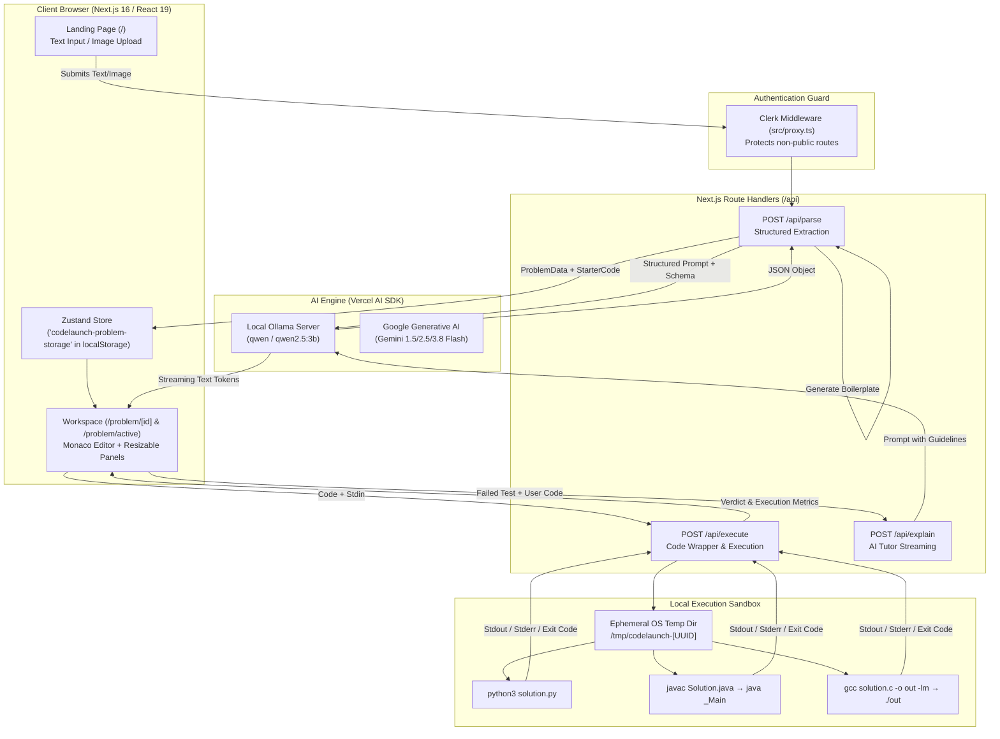

# CodeLaunch — Comprehensive System Architecture & Technical Specification

> **Document Version:** 1.0.0  
> **Last Updated:** October 2026  
> **Status:** Active / Production-Ready Core  

---

## 1. Project Overview & Mission

**CodeLaunch** is an AI-powered developer platform that transforms unstructured programming problems (raw text, problem statements, or screenshot images) into an interactive, LeetCode-style coding sandbox. 

### Core Capabilities
1. **Multimodal Problem Parsing:** Accepts raw problem statements or screenshot uploads/clipboard pastes, extracting clean Markdown descriptions, constraints, examples, and language-agnostic function signatures.
2. **Automatic Boilerplate Synthesis:** Server-side deterministic generation of starter solution skeletons for multiple languages (**Python**, **Java**, **C**).
3. **Interactive IDE Workspace:** Resizable split-screen interface using Monaco Editor, supporting customizable syntax themes, font ligatures, and multi-language switching.
4. **Local Sandboxed Code Execution:** Code compilation and runtime evaluation using a localized runner that dynamically wraps class-based solution code with test harnesses.
5. **Automated Test Validation:** Instant comparison of user code output against extracted official test cases, reporting execution time, standard error, and compilation diagnostics.
6. **Streaming AI Debugger & Tutor:** Real-time AI explanation of test failures, diagnosing bugs without spoiling exact solutions.

---

## 2. Complete Technology Stack

### 2.1 Frontend Architecture
| Layer / Library | Version | Purpose |
| :--- | :--- | :--- |
| **Framework** | Next.js 16.2.10 (App Router, Webpack/Turbopack) | Core SSR/CSR framework, routing, and server endpoints |
| **Library** | React 19.2.4 & React-DOM 19.2.4 | UI component primitives and concurrent rendering |
| **Language** | TypeScript 5.x | End-to-end static typing across frontend and backend |
| **Styling** | Tailwind CSS v4 (`@tailwindcss/postcss`) | Utility-first design system with custom theme tokens |
| **Editor** | `@monaco-editor/react` (v4.7.0) | VS Code-powered browser code editor with custom options |
| **Layout / Resizing** | `react-resizable-panels` (v4.12.0) | Draggable multi-pane layout (problem panel, editor, console) |
| **Icons** | `lucide-react` (v1.23.0) | Modern icon set across workspace and dashboard |
| **State Management** | `zustand` (v5.0.14) + `persist` middleware | Client-side reactive store persisted in `localStorage` |
| **Typography** | Google Fonts (`Geist`, `Geist Mono`) | Clean, legible developer typography |

### 2.2 Backend & Server Architecture
| Component | Technology | Role |
| :--- | :--- | :--- |
| **Runtime** | Node.js (v18+) | Next.js API Route Handlers runtime |
| **AI SDK** | Vercel AI SDK (`ai` v7.0.14) | Unified primitives (`generateObject`, `streamText`) |
| **AI Providers** | `@ai-sdk/openai` v4.0.83, `@ai-sdk/google` v4.0.8 | Provider adapters for Ollama & Gemini endpoints |
| **Validation** | `zod` v4.4.3 | Type-safe schema definition and structured LLM outputs |
| **Execution Engine**| Node.js `child_process` (`exec`), `fs/promises`, `os` | Ephemeral compilation & execution of Python, Java, C |
| **Auth & Security** | `@clerk/nextjs` (v7.5.12) | User authentication, session management, middleware guards |

### 2.3 Compilers & Local System Toolchains
* **Python 3:** `python3` runtime for interpreted script execution.
* **Java:** `javac` compiler and `java` JVM (class-path sandboxing).
* **C:** `gcc` (GNU Compiler Collection) with `-lm` math linking.

### 2.4 External & Sandbox Integrations
* **Ollama Instance:** Default local inference at `http://127.0.0.1:11434/v1`.
* **Judge0 Setup (Ready for remote containerization):** Configured via `judge0/judge0.conf` (PostgreSQL 5432, Redis 6379) for distributed sandboxing.
* **Tested API Alternatives:** Google Gemini API (`@ai-sdk/google`), Piston Execution API (`https://emkc.org/api/v2/piston`), and Wandbox.

---

## 3. High-Level System Architecture



---

## 4. AI & Data Models Specification

### 4.1 AI / LLM Models

#### 1. In-App Primary Models (Active in Codebase)
* **`qwen` / `qwen2.5:3b` (via Local Ollama)**
  * **Provider Connection:** `@ai-sdk/openai` targeting `http://127.0.0.1:11434/v1`.
  * **Role 1 (Problem Parsing):** Used in `/api/parse` via `generateObject()`. Extracts structured JSON from OCR/raw text conforming strictly to `ProblemSchema`.
  * **Role 2 (Failure Explanation):** Used in `/api/explain` via `streamText()`. Acts as a pedagogical tutor providing 2–4 sentence diagnostic guidance without giving away the direct code solution.

#### 2. Experimental / Benchmark Models (In Test Suites)
* **Google Gemini Suite (`@ai-sdk/google`):**
  * `gemini-1.5-flash`
  * `gemini-2.5-flash`
  * `gemini-3.8-flash`
  * Explored for ultra-fast cloud-based multi-modal extraction and large-context reasoning.

---

### 4.2 Core Data Models & Zod Schemas

#### 1. Function Parameter & Signature Schema (`src/app/api/parse/route.ts`)
```typescript
const FunctionParameterSchema = z.object({
  name: z.string().describe("Parameter name"),
  type: z.string().describe("Language-agnostic type, e.g. 'int[]', 'string', 'int'"),
});

const FunctionSignatureSchema = z.object({
  name: z.string().describe("The function/method name"),
  parameters: z.array(FunctionParameterSchema),
  returnType: z.string().describe("Return type in language-agnostic form"),
});
```

#### 2. Examples & Tests Schemas
```typescript
const OfficialExampleSchema = z.object({
  input: z.string().describe("Raw input string from the problem statement"),
  output: z.string().describe("Expected output from the problem statement"),
  explanation: z.string().optional().describe("Explanation if provided"),
});

const GeneratedTestSchema = z.object({
  input: z.string().describe("Input string for test case"),
  expectedOutput: z.string().describe("Expected output"),
  type: z.enum(["normal", "edge", "boundary", "stress"]),
  explanation: z.string().optional(),
});
```

#### 3. Complete Problem Schema (`ProblemSchema`)
```typescript
const ProblemSchema = z.object({
  title: z.string().describe("Short descriptive title"),
  description: z.string().describe("Full problem description in clean Markdown"),
  constraints: z.array(z.string()).describe("Constraint list, e.g. '1 <= n <= 10^5'"),
  inputFormat: z.string().optional(),
  outputFormat: z.string().optional(),
  examples: z.array(OfficialExampleSchema),
  functionSignature: FunctionSignatureSchema,
});
```

#### 4. Client State Model (`src/store/useProblemStore.ts`)
```typescript
export interface StarterCode {
  java: string;
  python: string;
  c: string;
  [key: string]: string;
}

export interface ProblemData {
  title: string;
  description: string;
  constraints: string[];
  inputFormat?: string;
  outputFormat?: string;
  examples: OfficialExample[];
  functionSignature: FunctionSignature;
  starterCode: StarterCode;
  generatedTests: GeneratedTest[];
}
```

---

## 5. End-to-End Inputs and Outputs (IPs & OPs)

### 5.1 Route: `POST /api/parse`
Transforms an unstructured prompt or screenshot into a structured challenge.

* **Input (Request Payload):**
  * `Content-Type: application/json` (Max size: 10MB)
  * Payload format:
    ```json
    {
      "problemText": "Optional raw text description of problem...",
      "imageBase64": "data:image/png;base64,iVBORw0KGgo..."
    }
    ```
* **Processing:**
  1. Validates base64 MIME prefix and non-empty inputs.
  2. Submits prompt + multimodal image block to Ollama.
  3. Enforces output alignment with `ProblemSchema`.
  4. Runs deterministic server-side boilerplate generator for Java, Python, and C.
* **Output (Response Payload):**
  * `Status 200 OK`:
    ```json
    {
      "title": "Two Sum",
      "description": "Given an array of integers `nums` and an integer `target`...",
      "constraints": ["2 <= nums.length <= 10^5", "-10^9 <= nums[i] <= 10^9"],
      "inputFormat": "Array nums and integer target",
      "outputFormat": "Array of two indices",
      "examples": [
        {
          "input": "nums = [2,7,11,15], target = 9",
          "output": "[0,1]",
          "explanation": "Because nums[0] + nums[1] == 9, we return [0, 1]."
        }
      ],
      "functionSignature": {
        "name": "twoSum",
        "parameters": [
          { "name": "nums", "type": "int[]" },
          { "name": "target", "type": "int" }
        ],
        "returnType": "int[]"
      },
      "starterCode": {
        "python": "from typing import List, Optional, Any\n\nclass Solution:\n    def twoSum(self, nums: List[int], target: int) -> List[int]:\n        pass",
        "java": "import java.util.*;\n\nclass Solution {\n    public int[] twoSum(int[] nums, int target) {\n        \n    }\n}",
        "c": "int* twoSum(int* nums, int numsSize, int target, int* returnSize) {\n    \n}"
      }
    }
    ```
  * `Status 400/413/422/500`: Standardized error response `{ "error": "Reason" }`.

---

### 5.2 Route: `POST /api/execute`
Executes user solution inside an ephemeral local runner with LeetCode harness adaptation.

* **Input (Request Payload):**
  ```json
  {
    "code": "class Solution:\n    def twoSum(self, nums, target):\n        return [0, 1]",
    "language": "python", // "python" | "java" | "c"
    "stdin": "nums = [2,7,11,15], target = 9",
    "wrapCode": true,
    "functionSignature": {
      "name": "twoSum",
      "parameters": [{ "name": "nums", "type": "int[]" }, { "name": "target", "type": "int" }],
      "returnType": "int[]"
    }
  }
  ```
* **Processing:**
  1. Creates temporary working directory `os.tmpdir()/codelaunch-<uuid>`.
  2. Injects harness wrapper:
     * **Python Wrapper:** Uses regex parameter stripper and JSON deserializer to parse stdin and dynamically invoke `getattr(Solution(), fnName)(*args)`. Serializes result to compact JSON.
     * **Java Wrapper:** Generates `_Main` class that tokenizes stdin, parses primitive/array arguments, instantiates `Solution`, calls method, and formats array prints.
     * **C Wrapper:** Generates `main()` function reading arguments via `scanf` and formatting array outputs.
  3. Executes compile command if applicable (`javac` / `gcc`).
  4. Runs code via `child_process.exec` with strict 8-second execution timeout and piped stdin.
  5. Cleans up temp directory asynchronously.
* **Output (Response Payload):**
  ```json
  {
    "stdout": "[0,1]",
    "stderr": "",
    "compile_output": "",
    "time": "0.045",
    "memory": 0,
    "status": {
      "id": 3,
      "description": "Accepted"
    }
  }
  ```
  *(Status IDs follow Judge0 conventions: 3 for Accepted, 6 for Compilation Error, 11 for Runtime Error).*

---

### 5.3 Route: `POST /api/explain`
Streams pedagogical debugging advice when a solution fails.

* **Input (Request Payload):**
  ```json
  {
    "problem": {
      "title": "Two Sum",
      "description": "Problem context snippet..."
    },
    "userCode": "class Solution: ...",
    "language": "python",
    "failedTest": {
      "input": "nums = [3,2,4], target = 6",
      "expectedOutput": "[1,2]",
      "actualOutput": "[0,1]"
    },
    "error": ""
  }
  ```
* **Processing:**
  * Injects tutor system instructions (concise, educational, points to buggy lines, prompts critical thinking, strictly under 200 words, no full code solutions).
  * Calls `streamText` on `qwen2.5:3b`.
* **Output (Response Stream):**
  * Returns `text/event-stream` / `text/plain` stream directly to the workspace console.

---

## 6. Detailed File and Directory Structure

```
CodeLaunch/
├── .env.local                    # Environment configuration (Clerk keys, Ollama URL)
├── package.json                  # Dependencies, scripts, and build metadata
├── tsconfig.json                 # TypeScript compiler configuration
├── next.config.ts                # Next.js configuration
├── postcss.config.mjs            # PostCSS configuration for Tailwind v4
├── README.md                     # High-level project documentation
│
├── judge0/                       # Sandbox cluster configuration (Self-hosted runner)
│   └── judge0.conf               # Redis and PostgreSQL credentials & host mapping
│
├── public/                       # Static public assets (SVGs, Icons)
│
├── src/
│   ├── proxy.ts                  # Clerk route guard middleware
│   │
│   ├── store/
│   │   └── useProblemStore.ts    # Zustand global state (persistent across reloads)
│   │
│   └── app/
│       ├── layout.tsx            # Root layout with ClerkProvider & Geist fonts
│       ├── globals.css           # Tailwind v4 theme variables, scrollbars & markdown styles
│       ├── page.tsx              # Landing page (drag-and-drop, image OCR, problem parser)
│       │
│       ├── sign-in/              # Clerk Authentication sign-in route
│       │   └── [[...sign-in]]/page.tsx
│       │
│       ├── sign-up/              # Clerk Authentication sign-up route
│       │   └── [[...sign-up]]/page.tsx
│       │
│       ├── problem/
│       │   ├── active/page.tsx   # Canonical redirect to active Zustand problem
│       │   └── [id]/page.tsx     # Full IDE workspace (Monaco, Resizable Panels, Test runner)
│       │
│       └── api/
│           ├── parse/route.ts    # Multimodal LLM parser + boilerplate generator
│           ├── execute/route.ts  # Multi-language sandboxed wrapper & execution engine
│           └── explain/route.ts  # LLM failure analysis & streaming hints
│
└── test-*.ts / test-*.js         # Standalone testbeds (Gemini, Ollama, Piston, Wandbox)
```

---

## 7. Security, Sandboxing, and Production Considerations

1. **Authentication:** All private routes and API endpoints are guarded via `clerkMiddleware` (`src/proxy.ts`). Public routes include `/sign-in` and `/sign-up`.
2. **Execution Isolation:** Current execution runs in ephemeral directories in `os.tmpdir()`. Production scaling should route requests through the included `judge0` configuration or a Docker/gVisor microVM sandbox to prevent container breakout.
3. **Execution Limits:** Strict wall-clock timeouts of 15 seconds for compilation and 8 seconds for program execution prevent infinite loop hanging.
4. **Input Sanitization:** Parameter stripping and regex sanitization in Python/Java runners prevent shell injection during execution.
